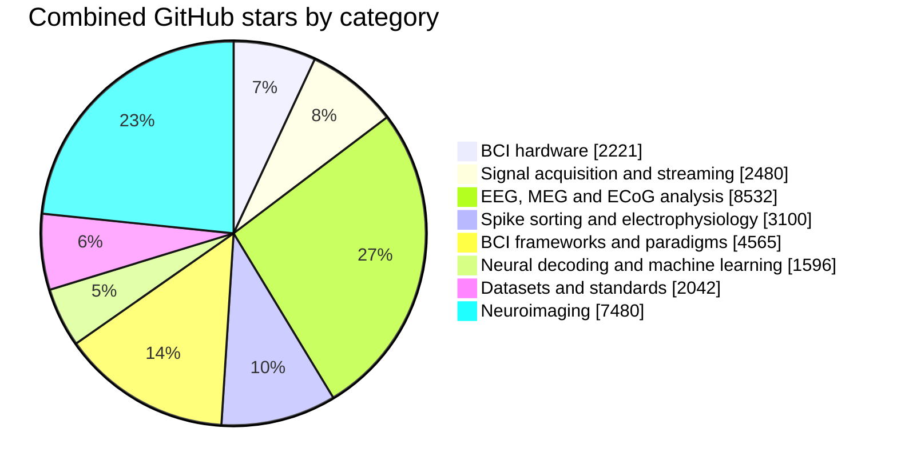

# Awesome Craft Neuro 

> A curated list of open-source tools for brain-computer interfaces, electrophysiology and neurotechnology.

Open-source tools now cover much of the neural-data stack: board-level acquisition, streaming, EEG and MEG analysis, spike sorting, BCI experiment frameworks, neural decoding, shared datasets, and MRI pipelines. Every entry below has a public GitHub repository that was checked on 2026-11-15. Check each project's licence before you use, modify or redistribute it.

**Ethics and medical safety:** nothing in this list is a medical device, a treatment, or clinical advice. Invasive brain-computer interfaces and implant hardware are subject to medical-device regulation, institutional review and surgical oversight. Consumer or research EEG hardware is not a diagnostic instrument. Do not treat company announcements, press photos or blog posts as evidence of safety or efficacy.

This snapshot of the [neuralink](https://github.com/neuralink) GitHub organisation found two public repositories, `tsui` (a Tailscale terminal UI) and `DicomPreview` (a macOS Quick Look plugin for DICOM files). Neither is implant or BCI software, so they are not listed as tools here. A public Neuralink compression-challenge repository was not found on that organisation. Published patient-count or milestone claims from companies are GOAL or company statements unless they come from a peer-reviewed paper or a regulator.

Official BCI2000 and OpenViBE distributions were not found as maintained public GitHub repositories in this snapshot, so they are not listed. The same is true for official POYO and Neural Data Transformer (NDT) source repositories.

## Contents

- [Dashboard](#dashboard)
- [BCI hardware](#bci-hardware)
- [Signal acquisition and streaming](#signal-acquisition-and-streaming)
- [EEG, MEG and ECoG analysis](#eeg-meg-and-ecog-analysis)
- [Spike sorting and electrophysiology](#spike-sorting-and-electrophysiology)
- [BCI frameworks and paradigms](#bci-frameworks-and-paradigms)
- [Neural decoding and machine learning](#neural-decoding-and-machine-learning)
- [Datasets and standards](#datasets-and-standards)
- [Neuroimaging](#neuroimaging)
- [Related lists](#related-lists)
- [Star history](#star-history)

## Dashboard

<table>
<tr>
<td align="center"><h2>60</h2>listed projects</td>
<td align="center"><h2>8</h2>categories</td>
<td align="center"><h2>32.0k</h2>combined GitHub stars</td>
<td align="center"><h2>12.6k</h2>combined forks</td>
<td align="center"><h2>40/60</h2>pushed in the last 30 days</td>
<td align="center"><h2>8</h2>languages</td>
</tr>
</table>

**Evidence tags**

<table>
<tr><th>Tag</th><th>Style</th><th>Meaning</th></tr>
<tr><td>FACT</td><td>solid underline</td><td>A measured figure, with the source named.</td></tr>
<tr><td>GOAL</td><td>dashed underline</td><td>A stated roadmap, plan or company claim, not a verified result.</td></tr>
<tr><td>ESTIMATE</td><td>dotted underline</td><td>A sum or count we computed from the facts.</td></tr>
</table>

The dashboard numbers themselves are FACT or ESTIMATE values from GitHub. This snapshot has no GOAL figures in the table above. Company claims about implants, patients or performance should be read as GOAL unless a paper or regulator is cited.

**Sources and method**

- Star counts, fork counts, licences, primary languages and last-push dates are FACT values from the GitHub Search and REST APIs on 2026-11-15 (`stargazers_count`, `forks_count`, `license.spdx_id`, `language`, `pushed_at`).
- Combined stars (32.0k) and combined forks (12.6k) are ESTIMATEs: the arithmetic sum of those per-repository FACT counts, with no weighting and no unique-user deduplication. A person who stars two projects is counted twice.
- Pushed in the last 30 days (40/60) is an ESTIMATE: the number of listed repositories whose FACT `pushed_at` date is on or after 2026-10-16.
- Language and category counts, and the licence badges, are ESTIMATEs of FACT fields. Star badges next to each entry update live and may differ from this snapshot.

### 🏆 Leaderboard

Star counts in this table are FACT values from the snapshot. The bars are only a visual scale.

<table>
<tr><th>Rank</th><th>Project</th><th>Kind</th><th align="right">Stars</th><th></th></tr>
<tr><td align="center">🥇</td><td><b>MNE-Python</b></td><td>EEG, MEG and ECoG analysis</td><td align="right">3.6k</td><td><code>████████████████████</code></td></tr>
<tr><td align="center">🥈</td><td><b>BrainFlow</b></td><td>Signal acquisition and streaming</td><td align="right">1.8k</td><td><code>██████████</code></td></tr>
<tr><td align="center">🥉</td><td><b>ANTs</b></td><td>Neuroimaging</td><td align="right">1.5k</td><td><code>████████</code></td></tr>
<tr><td align="center">4</td><td><b>Nilearn</b></td><td>Neuroimaging</td><td align="right">1.5k</td><td><code>████████</code></td></tr>
<tr><td align="center">5</td><td><b>Braindecode</b></td><td>BCI frameworks and paradigms</td><td align="right">1.3k</td><td><code>███████</code></td></tr>
<tr><td align="center">6</td><td><b>CEBRA</b></td><td>Neural decoding and machine learning</td><td align="right">1.1k</td><td><code>██████</code></td></tr>
<tr><td align="center">7</td><td><b>MOABB</b></td><td>BCI frameworks and paradigms</td><td align="right">1.1k</td><td><code>██████</code></td></tr>
<tr><td align="center">8</td><td><b>FieldTrip</b></td><td>EEG, MEG and ECoG analysis</td><td align="right">993</td><td><code>██████</code></td></tr>
<tr><td align="center">9</td><td><b>OpenBCI GUI</b></td><td>BCI hardware</td><td align="right">983</td><td><code>█████</code></td></tr>
<tr><td align="center">10</td><td><b>FreeSurfer</b></td><td>Neuroimaging</td><td align="right">887</td><td><code>█████</code></td></tr>
</table>

### Stars by category

These category totals are ESTIMATE sums of the per-repository FACT star counts.

### Licences

        

These badge counts are ESTIMATE tallies of the SPDX identifier GitHub returned for each repository. "Custom" or "None" means GitHub could not match a standard SPDX licence. The BIDS specification uses CC-BY-4.0, a content licence rather than a typical OSI software licence. FreeSurfer has long used a custom academic licence rather than an OSI licence. Read each project licence before you use it commercially or in a clinic.

## BCI hardware

- [FreeEEG32](https://github.com/neuroidss/FreeEEG32-beta) - Open hardware for a 32-channel mobile EEG based on AD777x converters. Last push 2025-11-14. 
- [HackEEG Python client](https://github.com/starcat-io/hackeeg-client-python) - Python client for the HackEEG ADS1299 Arduino shield. 
- [HackEEG shield](https://github.com/starcat-io/hackeeg-shield) - Hardware design files for an ADS1299 Arduino EEG shield. GitHub could not match a standard SPDX licence, and the last push was 2021-06-03. 
- [Neurosity SDK for JavaScript](https://github.com/neurosity/neurosity-sdk-js) - Official JavaScript SDK for Neurosity headsets. 
- [Neurosity SDK for Python](https://github.com/neurosity/neurosity-sdk-python) - Official Python SDK for Neurosity headsets. 
- [OpenBCI Cyton library](https://github.com/OpenBCI/OpenBCI_Cyton_Library) - Arduino firmware library for the OpenBCI Cyton board. Last push 2025-07-28. 
- [OpenBCI GUI](https://github.com/OpenBCI/OpenBCI_GUI) - Cross-platform application for acquiring and visualising data from OpenBCI Cyton and Ganglion boards. 
- [Ultracortex](https://github.com/OpenBCI/Ultracortex) - 3D-printable EEG headset files from OpenBCI. Last push 2022-09-29. 

## Signal acquisition and streaming

- [BrainFlow](https://github.com/brainflow-dev/brainflow) - Library to acquire, parse and analyse EEG, EMG, ECG and other biosignals from many boards. GitHub could not match a standard SPDX licence. 
- [Lab Recorder](https://github.com/labstreaminglayer/App-LabRecorder) - Application that records one or more Lab Streaming Layer streams to XDF files. 
- [liblsl](https://github.com/sccn/liblsl) - C++ core library for Lab Streaming Layer, used to time-synchronise multimodal streams on a local network. GitHub could not match a standard SPDX licence. 
- [MNE-LSL](https://github.com/mne-tools/mne-lsl) - Real-time brain-signal streaming framework that connects Lab Streaming Layer to MNE-Python. 
- [pylsl](https://github.com/labstreaminglayer/pylsl) - Python bindings for liblsl. 

## EEG, MEG and ECoG analysis

- [autoreject](https://github.com/autoreject/autoreject) - Automated rejection and repair of bad trials and sensors in M/EEG data. 
- [Brainstorm](https://github.com/brainstorm-tools/brainstorm3) - MATLAB environment for MEG, EEG, fNIRS, ECoG, sEEG and electrophysiology analysis. 
- [EEG-ExPy](https://github.com/NeuroTechX/EEG-ExPy) - Python collection of EEG experiment paradigms from NeuroTechX, formerly EEG-Notebooks. 
- [EEGLAB](https://github.com/sccn/eeglab) - MATLAB toolbox for electrophysiological signal processing, developed at SCCN. GitHub could not match a standard SPDX licence. 
- [FieldTrip](https://github.com/fieldtrip/fieldtrip) - MATLAB toolbox for MEG, EEG and intracranial EEG analysis. 
- [FOOOF](https://github.com/fooof-tools/fooof) - Tool for parameterising neural power spectra into periodic and aperiodic components, also known as specparam. 
- [MNE-Python](https://github.com/mne-tools/mne-python) - Python package for acquiring, preprocessing, analysing and visualising MEG, EEG and other electrophysiological data. 
- [MNELAB](https://github.com/cbrnr/mnelab) - Graphical user interface for MNE-Python. 
- [NeuroDSP](https://github.com/neurodsp-tools/neurodsp) - Digital signal processing tools for neural time series. 
- [PyPREP](https://github.com/sappelhoff/pyprep) - Python implementation of the PREP pipeline for EEG preprocessing. 
- [YASA](https://github.com/raphaelvallat/yasa) - Python package for analysing polysomnographic sleep recordings, including EEG spindle and staging tools. 

## Spike sorting and electrophysiology

- [Elephant](https://github.com/NeuralEnsemble/elephant) - Electrophysiology analysis toolkit built on Neo, covering spike-train and LFP statistics. 
- [Intan RHX](https://github.com/Intan-Technologies/Intan-RHX) - Free data-acquisition software from Intan Technologies for displaying and recording signals from Intan hardware. 
- [Kilosort](https://github.com/MouseLand/Kilosort) - Fast spike-sorting algorithm with drift correction, developed by MouseLand. 
- [MountainSort 5](https://github.com/flatironinstitute/mountainsort5) - MountainSort spike-sorting algorithm, version 5, from the Flatiron Institute. 
- [Neo](https://github.com/NeuralEnsemble/python-neo) - Python package for representing electrophysiology data and reading many acquisition formats. 
- [Open Ephys GUI](https://github.com/open-ephys/plugin-GUI) - Modular software for processing, recording and visualising multichannel electrophysiology. 
- [Open Ephys Python tools](https://github.com/open-ephys/open-ephys-python-tools) - Python tools for interacting with the Open Ephys GUI and its data formats. Last push 2025-11-07. 
- [phy](https://github.com/cortex-lab/phy) - Interactive visualisation and manual curation tool for large-scale spike-sorted ephys data. 
- [SpikeGLX](https://github.com/billkarsh/SpikeGLX) - Recording-system GUI widely used with Neuropixels and National Instruments hardware. GitHub could not match a standard SPDX licence. 
- [SpikeInterface](https://github.com/SpikeInterface/spikeinterface) - Python framework for building flexible spike-sorting pipelines, with wrappers for many sorters. 

## BCI frameworks and paradigms

- [BciPy](https://github.com/CAMBI-tech/BciPy) - Python research software for building and running BCI experiments, from CAMBI. 
- [Braindecode](https://github.com/braindecode/braindecode) - Deep-learning library for decoding EEG, ECG and MEG signals. 
- [EEGsynth](https://github.com/eegsynth/eegsynth) - Modular system that converts real-time EEG into sound, music and visual effects. 
- [MetaBCI](https://github.com/TBC-TJU/MetaBCI) - Open-source platform for non-invasive BCI research, led by Tianjin University. 
- [MOABB](https://github.com/NeuroTechX/moabb) - Mother of All BCI Benchmarks, a framework for reproducible EEG decoding experiments. 
- [pyRiemann](https://github.com/pyRiemann/pyRiemann) - Machine learning for multivariate biosignals using the Riemannian geometry of covariance matrices. 
- [Timeflux](https://github.com/timeflux/timeflux) - Python framework for real-time biosignal processing and BCI applications. Last push 2024-12-04. 

## Neural decoding and machine learning

- [CEBRA](https://github.com/AdaptiveMotorControlLab/CEBRA) - Learnable latent embeddings for jointly analysing behavioural and neural data. GitHub could not match a standard SPDX licence. 
- [NLB tools](https://github.com/neurallatents/nlb_tools) - Python tools for the Neural Latents Benchmark, a challenge on inferring latent dynamics from neural population recordings. 
- [pynapple](https://github.com/pynapple-org/pynapple) - Lightweight Python library for analysing neurophysiological data, including tuning, decoding and sleep-related metrics. 

## Datasets and standards

- [BIDS specification](https://github.com/bids-standard/bids-specification) - The Brain Imaging Data Structure standard. It uses CC-BY-4.0, a content licence rather than a typical OSI software licence. 
- [BIDS Validator](https://github.com/bids-standard/bids-validator) - Validator for datasets that follow the Brain Imaging Data Structure. 
- [DANDI CLI](https://github.com/dandi/dandi-cli) - Command-line client for the DANDI archive of cellular neurophysiology data stored with NWB. 
- [HDMF](https://github.com/hdmf-dev/hdmf) - Hierarchical Data Modeling Framework used by NWB. GitHub could not match a standard SPDX licence. 
- [OpenNeuro](https://github.com/OpenNeuroOrg/openneuro) - Free platform for sharing and analysing neuroimaging datasets, typically in BIDS. 
- [PyBIDS](https://github.com/bids-standard/pybids) - Python tools for querying and manipulating BIDS datasets. 
- [PyNWB](https://github.com/NeurodataWithoutBorders/pynwb) - Python API for reading and writing data in the Neurodata Without Borders (NWB) format. GitHub could not match a standard SPDX licence. 
- [WFDB Python](https://github.com/MIT-LCP/wfdb-python) - Python toolkit for reading, writing and processing PhysioNet WFDB signals and annotations. 

## Neuroimaging

- [ANTs](https://github.com/ANTsX/ANTs) - Advanced Normalization Tools for medical image registration, segmentation and template building. 
- [DIPY](https://github.com/dipy/dipy) - Python library for diffusion MRI and other 3D/4D medical imaging analysis. GitHub could not match a standard SPDX licence. 
- [fMRIPrep](https://github.com/nipreps/fmriprep) - Robust, easily used pipeline for preprocessing diverse fMRI datasets. 
- [FreeSurfer](https://github.com/freesurfer/freesurfer) - Suite for neuroimaging analysis and visualisation, including cortical surface reconstruction. GitHub could not match a standard SPDX licence, and the project has long used a custom academic licence rather than an OSI licence, so read it before you use the software. 
- [MRtrix3](https://github.com/MRtrix3/mrtrix3) - Tools for advanced diffusion MRI analysis, including tractography and fibre-orientation estimation. 
- [NiBabel](https://github.com/nipy/nibabel) - Python package for reading and writing many neuroimaging file formats. GitHub could not match a standard SPDX licence. 
- [Nilearn](https://github.com/nilearn/nilearn) - Python library for statistical and machine-learning analysis of neuroimaging data. 
- [Nipype](https://github.com/nipy/nipype) - Python workflows and interfaces that connect neuroimaging packages into reproducible pipelines. GitHub could not match a standard SPDX licence. 

## Related lists

Other lists in the Awesome Craft series:

- [Awesome Craft](https://github.com/EdisonTKPcom/Awesome-Craft) - A curated list of open-source, self-hostable alternatives to popular SaaS tools.
- [Awesome Craft Agents](https://github.com/EdisonTKPcom/Awesome-Craft-Agents) - A curated list of open-source chat apps, coding agents, self-hosted agent bots, workflow automation and image-generation UIs.
- [Awesome Craft AI](https://github.com/EdisonTKPcom/Awesome-Craft-AI) - A curated list of open-source, self-hostable AI runtimes, servers, Hugging Face libraries and related infrastructure.
- [Awesome Craft BSC](https://github.com/EdisonTKPcom/Awesome-Craft-BSC) - A curated list of verified open-source clients, SDKs, dev tools and protocol code for BNB Smart Chain and opBNB.
- [Awesome Craft CUDA](https://github.com/EdisonTKPcom/Awesome-Craft-CUDA) - A curated list of open-source CUDA learning material, kernel libraries, tooling and portability projects.
- [Awesome Craft DeepSeek](https://github.com/EdisonTKPcom/Awesome-Craft-DeepSeek) - A curated list of official DeepSeek repositories and open-source harnesses, serving engines, eval tools and fine-tuning stacks that work with DeepSeek models.
- [Awesome Craft DevOps](https://github.com/EdisonTKPcom/Awesome-Craft-DevOps) - A curated list of open-source, self-hostable alternatives to popular DevOps and hosting SaaS tools.
- [Awesome Craft DNA](https://github.com/EdisonTKPcom/Awesome-Craft-DNA) - A curated list of open-source tools for DNA, genomics and synthetic biology.
- [Awesome Craft Ethereum](https://github.com/EdisonTKPcom/Awesome-Craft-Ethereum) - A curated list of verified open-source Ethereum clients, SDKs, dev frameworks, wallets and security tools.
- [Awesome Craft EV](https://github.com/EdisonTKPcom/Awesome-Craft-EV) - A curated list of open-source software and hardware for electric vehicles and charging.
- [Awesome Craft Hardware](https://github.com/EdisonTKPcom/Awesome-Craft-Hardware) - A curated list of open-source tools for PCB, FPGA, ASIC and chip design.
- [Awesome Craft Hyperliquid](https://github.com/EdisonTKPcom/Awesome-Craft-Hyperliquid) - A curated list of verified open-source SDKs, node tools, analytics and community libraries for the Hyperliquid ecosystem.
- [Awesome Craft Malaysia](https://github.com/EdisonTKPcom/Awesome-Craft-Malaysia) - A curated list of open-source tools useful to Malaysian SMEs, with verified MyInvois support called out separately.
- [Awesome Craft Mars](https://github.com/EdisonTKPcom/Awesome-Craft-Mars) - A curated list of open-source tools and open data for Mars missions and settlement planning.
- [Awesome Craft Robotics](https://github.com/EdisonTKPcom/Awesome-Craft-Robotics) - A curated list of open-source robotics software and hardware, including Microduck, Unitree SDKs, open humanoids, arms, simulation and middleware.
- [Awesome Craft Solana](https://github.com/EdisonTKPcom/Awesome-Craft-Solana) - A curated list of verified open-source Solana clients, SDKs, frameworks, explorers and program libraries.
- [Awesome Craft Space](https://github.com/EdisonTKPcom/Awesome-Craft-Space) - A curated list of open-source tools for spaceflight and rockets, covering orbit simulation, telemetry, launch data and more.
- [Awesome Craft Starlink](https://github.com/EdisonTKPcom/Awesome-Craft-Starlink) - A curated list of open-source tools for Starlink and other LEO satellite internet systems.
- [Awesome Craft Web3](https://github.com/EdisonTKPcom/Awesome-Craft-Web3) - A curated list of open-source DEX protocol code, self-custody software, indexers, frameworks and Blockchain infrastructure.

## Star history

## Contributing

Contributions welcome! Read the [contribution guidelines](contributing.md) first.

If this list helped you find a tool, give it a ⭐ so others can find it.

